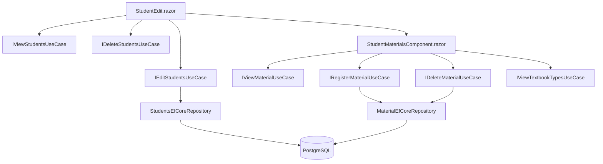

# Requirements

### Overview & Goals
Finish and fix `StudentEdit.razor` (`/edit-aluno/{StudentId:int}`) and its underlying repository method so that student details can be successfully updated. Additionally, integrate a component on the student edit page to display all materials (textbooks) assigned to the student, with controls to add a new material or remove an existing one.

### Scope
**In Scope**
- **Repository bug fix:** Fix `StudentsEfCoreRepository.EditStudentAsyc` which currently attempts to overwrite the primary key `StudentId` with `TextbookId` and incorrectly assigns `Group` rather than `GroupId`.
- **Student Edit Form (`StudentEdit.razor`):**
  - Fix page headings, labels, and delete confirmation popups to use Portuguese student terminology ("Editar Aluno", "Deseja realmente apagar este aluno?", etc.).
  - Fix form validations (correct `ValidationMessage` bindings for `BirthDate` and `GroupId`).
  - Wire the `Update()` and `DeleteStudent()` methods to save changes and redirect to `/alunos`.
- **Student Materials Component:**
  - Create a dedicated component (`Controls/StudentMaterialsComponent.razor`) or embedded sub-view to display a table of all textbooks assigned to the current student.
  - Provide an inline / dialog form to add a new material for the student (selecting `TextBookType`, setting title/hours/engagement, and saving via `IRegisterMaterialUseCase`).
  - Provide a button on each material row to remove (delete) the material via `IDeleteMaterialUseCase`.
  - Refresh the student's material list immediately upon adding or removing a material.

**Out of Scope**
- Changing the database schema or creating new migrations (the 1-to-many relationship between `Student` and `Textbook` is already configured in EF Core).
- Modifying other unrelated pages (e.g., `TextbooksList.razor`, `ContractsList.razor`).

### User Stories
- As an administrator/user, I want to edit a student's personal info (Name, BirthDate, CPF, RG, Group) on `/edit-aluno/{id}` and have the changes saved to the database so that student records remain up to date.
- As an administrator/user, I want to see the list of materials assigned to the student directly on their edit page so that I can track their assigned textbooks.
- As an administrator/user, I want to add a new material for the student from their edit page so that I don't have to navigate to another page to assign textbooks.
- As an administrator/user, I want to remove an assigned material from a student directly from their edit page when it is no longer needed.

### Functional Requirements
- **Student Editing:**
  - Route: `/edit-aluno/{StudentId:int}`.
  - Fields: Nome (`Name`), CPF, RG, Data de Nascimento (`BirthDate`), and Turma (`GroupId`).
  - Group dropdown shows all active groups with teacher name (`_groups`).
  - "Salvar" button submits form, calls `IEditStudentsUseCase.ExecuteAsync(_student)`, and redirects to `/alunos`.
  - "Cancelar" button navigates back to `/alunos`.
  - "Apagar" button opens `Popup` confirmation ("Deseja realmente apagar este aluno?") and on confirm calls `IDeleteStudentsUseCase.ExecuteAsync(StudentId)` before redirecting to `/alunos`.
  - If student is not found, displays an error / not found message and calls `Navigator.NotFound()`.
- **Student Materials Section:**
  - Section title: "Materiais do Aluno" with count of assigned materials.
  - Displays a table/grid of materials linked to `StudentId` with columns: Título, Tipo de Material, Horas Dedicadas, Engajamento, and Ações.
  - If no materials are assigned, displays "Nenhum material associado a este aluno."
  - **Add Material:**
    - Dropdown to select a `TextBookType` from available catalog items.
    - Fields for Title (defaults to chosen type's title), HoursSpent, and Engagement.
    - "Adicionar Material" button creates the `Textbook` entity with `StudentId = StudentId`, invokes `IRegisterMaterialUseCase.ExecuteAsync(textbook)`, and refreshes the student's materials table.
  - **Remove Material:**
    - "Remover" button on each row invokes `IDeleteMaterialUseCase.ExecuteAsync(materialId)` and refreshes the table.

# Technical Design

### Current Implementation & Root Cause Analysis
- **`StudentsEfCoreRepository.EditStudentAsyc` Bug:**
  - Lines 32-33:
    ```csharp
    Student.Group = student.Group;
    Student.StudentId = student.TextbookId;
    ```
    Modifying `Student.StudentId` causes EF Core to throw an `InvalidOperationException` because primary key properties cannot be modified. Additionally, `Student.Group = student.Group` does not properly update `Student.GroupId` when navigation properties are null.
- **`StudentEdit.razor` Issues:**
  - Heading says `<h3>Editar Material</h3>` instead of `<h3>Editar Aluno</h3>`.
  - NotFound text says `<h1>Material não encontrado</h1>`.
  - Delete popup text says `"Deseja realmente apagar este material?"`.
  - `<ValidationMessage For="() => _student.Name"/>` is duplicated for `BirthDate`.
  - `<ValidationMessage For="() => _student.Group"/>` is used instead of `GroupId`.
  - Materials placeholder is only an empty `<datalist></datalist>`.

### Key Decisions
- **Fix `StudentsEfCoreRepository.EditStudentAsyc`:**
  - Update `Student.Name = student.Name`, `Student.RG = student.RG`, `Student.CPF = student.CPF`, `Student.BirthDate = student.BirthDate`, `Student.GroupId = student.GroupId`. Remove the `StudentId` reassignment.
- **Dedicated `StudentMaterialsComponent`:**
  - Encapsulate the student's materials table, add form, and delete actions inside `Jedster.WebApp/Components/Pages/Controls/StudentMaterialsComponent.razor`.
  - Injects `IViewMaterialUseCase`, `IRegisterMaterialUseCase`, `IDeleteMaterialUseCase`, and `IViewTextbookTypesUseCase`.
  - Accepts `[Parameter] public int StudentId { get; set; }`.
  - Loads all materials where `t.StudentId == StudentId` and allows inline/dialog addition and row removal.
- **Consistent Portuguese UI & MudBlazor Styling:**
  - Follow the existing application patterns (Bootstrap input-groups for the main form, MudTable / MudCard or styled HTML tables for the materials sub-list, and Popup confirmation for deletion).

### Proposed Changes
- **`Jedster.Plugins/Jedster.Plugins.EntityFrameworkCorePSQL/StudentsEFCoreRepository.cs`:**
  - Fix `EditStudentAsyc` to map `GroupId`, `Name`, `RG`, `CPF`, `BirthDate` and remove `Student.StudentId = student.TextbookId`.
- **`Jedster.WebApp/Components/Pages/Controls/StudentMaterialsComponent.razor`:**
  - Create the component to manage the student's materials list with add and remove actions.
- **`Jedster.WebApp/Components/Pages/Students/StudentEdit.razor`:**
  - Clean up imports, headers, validations, group dropdown options, integrate `<StudentMaterialsComponent StudentId="StudentId" />`, and fix `Update` / `DeleteStudent` logic.

### File Structure
```
Jedster.Plugins/Jedster.Plugins.EntityFrameworkCorePSQL/
  StudentsEFCoreRepository.cs                     (modified)
Jedster.WebApp/Components/Pages/
  Controls/StudentMaterialsComponent.razor        (new)
  Students/StudentEdit.razor                      (modified)
```

### Architecture Diagram


### Risks & Mitigations
- **Concurrent DB Updates:** Ensure `StudentMaterialsComponent` does not conflict with the student form submit by executing material additions/deletions immediately via their respective use cases and reloading the material collection.
- **Foreign Key Constraints:** Ensure added materials have a valid `StudentId` and `TextbookTypeId > 0`.
- **Validation Messages:** Ensure `[Required]` properties on `Student` (`Name`, `RG`, `CPF`, `GroupId`) pass `DataAnnotationsValidator`.

# Testing

### Validation Approach
- Compile solution with `dotnet build Jedster.slnx` and ensure 0 compilation errors.
- Run `lint_files` on `StudentsEFCoreRepository.cs`, `StudentMaterialsComponent.razor`, and `StudentEdit.razor`.
- Verify runtime behavior by running the WebApp and requesting `/edit-aluno/{id}`.

### Key Scenarios
- **Student Data Update:** Navigating to `/edit-aluno/31`, editing Name/CPF/RG/Group/BirthDate and clicking "Salvar" saves the changes to PostgreSQL and redirects to `/alunos`.
- **Materials List Display:** Displays all textbooks currently assigned to the student with their type name, hours, and engagement.
- **Add Material:** Selecting a textbook type and clicking "Adicionar" creates a new `Textbook` for this student and updates the table without page reload.
- **Remove Material:** Clicking "Remover" deletes the textbook from the database and updates the table.
- **Student Delete:** Clicking "Apagar" opens confirmation popup and deletes student on confirmation.

### Edge Cases
- Invalid or missing `StudentId` in route redirects or shows 404.
- Attempting to add a material without selecting a valid textbook type shows validation error.
- Student without materials displays an informative empty state.

# Delivery Steps

### ✓ Step 1: Fix StudentsEfCoreRepository.EditStudentAsyc bug
The repository updates student fields without throwing primary key modification errors.

- In `StudentsEFCoreRepository.cs`:
  - Fix `EditStudentAsyc`: assign `Student.Name`, `Student.RG`, `Student.CPF`, `Student.BirthDate`, and `Student.GroupId = student.GroupId`.
  - Remove `Student.StudentId = student.TextbookId;` and `Student.Group = student.Group;`.
- Run solution build to verify compilation.

### ✓ Step 2: Implement StudentMaterialsComponent for student material management
Users can view, add, and remove materials assigned to a student.

- Create `Jedster.WebApp/Components/Pages/Controls/StudentMaterialsComponent.razor`:
  - Accept `[Parameter] public int StudentId { get; set; }`.
  - Injects `IViewMaterialUseCase`, `IRegisterMaterialUseCase`, `IDeleteMaterialUseCase`, `IViewTextbookTypesUseCase`.
  - Displays a table/grid of textbooks matching `StudentId` (Title, Type Title, Hours Spent, Engagement, Remove button).
  - Includes an add section with a dropdown of `TextBookType`, input for Title (with fallback to type title), Hours, Engagement, and an "Adicionar" button.
  - Implement material deletion via `IDeleteMaterialUseCase` and refresh list.
- Run linter on the new component.

### ✓ Step 3: Complete and fix StudentEdit.razor
The student edit form is fully functional, validated, localized, and integrates the materials component.

- Update `Jedster.WebApp/Components/Pages/Students/StudentEdit.razor`:
  - Correct headers and text to Portuguese ("Editar Aluno", "Aluno não encontrado", "Deseja realmente apagar este aluno?").
  - Fix `ValidationMessage` bindings for `BirthDate` and `GroupId`.
  - Ensure group `<InputSelect>` renders options cleanly.
  - Embed `<StudentMaterialsComponent StudentId="StudentId" />` below the student fields.
  - Fix `Update()` method to execute `EditStudentsUseCase.ExecuteAsync(_student)` and navigate to `/alunos`.
  - Fix `DeleteStudent()` to execute `DeleteStudentsUseCase.ExecuteAsync(id)` and navigate to `/alunos`.
- Run linter on `StudentEdit.razor`.

### ✓ Step 4: Build, lint, and verify student editing and material operations
The complete student editing workflow builds cleanly and passes quality checks.

- Run full solution build (`dotnet build Jedster.slnx`) and verify 0 errors.
- Run `lint_files` across all modified files.
- Verify page routes and database integration.